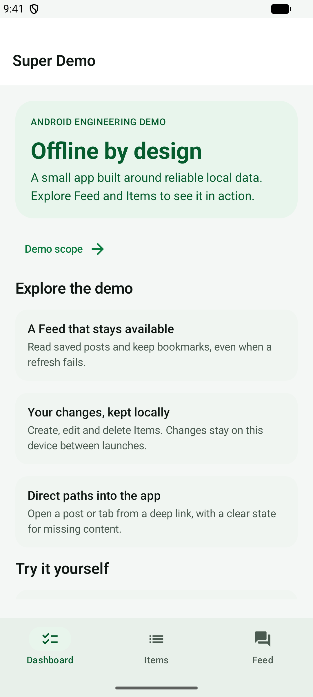
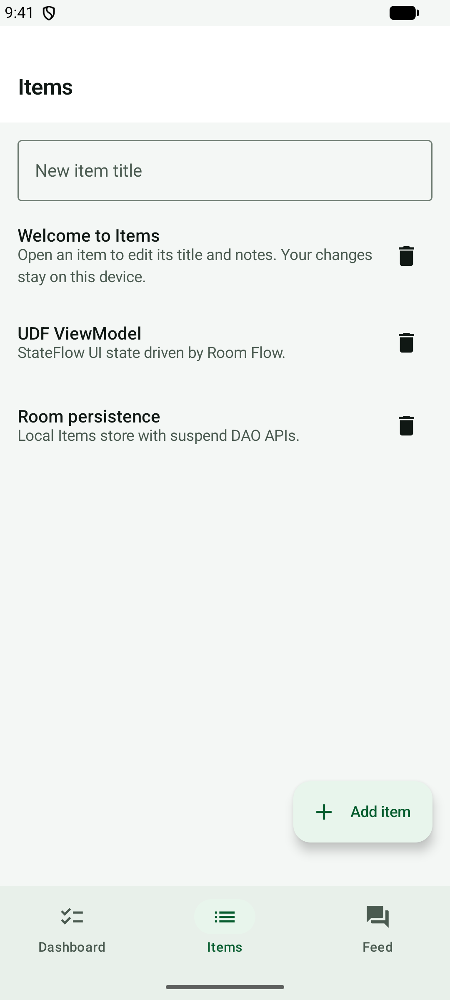
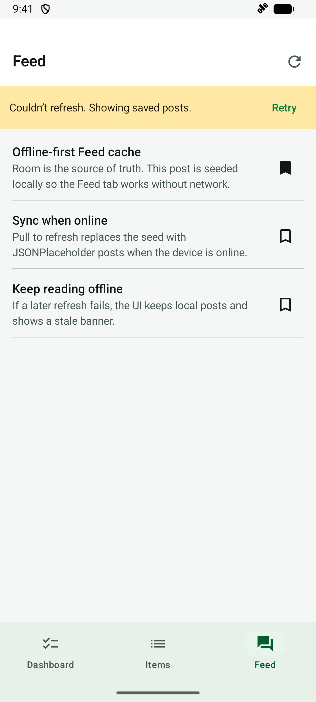
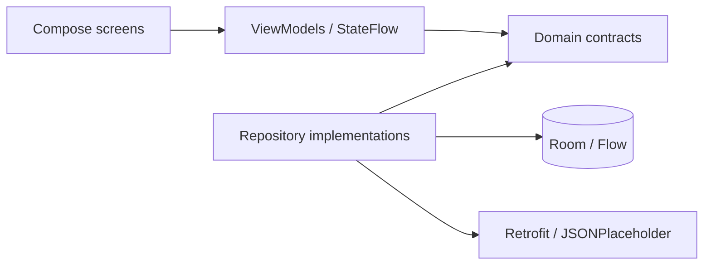

[](https://github.com/redjadet/super_demo_android/actions/workflows/ci.yml)
[](https://github.com/redjadet/super_demo_android/actions/workflows/emulator.yml)


[](LICENSE)

# Super Demo · Android

An Android engineering demo built with **Kotlin, Jetpack Compose and Room**.
Explore offline reading, persistent edits and deep links in a small codebase
with explicit feature boundaries and reproducible tests.

[Technical review](docs/EVIDENCE.md) · [3-minute demo](docs/portfolio.md#3-minute-path) ·
[Architecture](docs/architecture-tour.md) · [Build and run](docs/build-and-run.md)

| Dashboard | Items | Offline Feed |
| :---: | :---: | :---: |
|  |  |  |

*Android emulator captures with sample data. [Demo scope and screenshots](docs/portfolio.md#screenshots).*

## What the demo shows

- **Offline Feed:** Room drives the list. A failed refresh keeps saved posts visible
  with a clear retry state; bookmarks survive successful refreshes.
- **Persistent Items:** create, edit and delete local entries. Sample Items seed once,
  so deleting them leaves an empty list across launches.
- **Direct navigation:** open tabs and Feed posts through `superdemo://` deep links,
  including a defined missing-post state.
- **Compose UI:** Material 3 light and dark themes, labeled actions, scrollable
  details and constrained content width on larger windows.

## Start a technical review

**Lead case: preserve a bookmark changed during refresh.** A network response must
not overwrite a newer local toggle. The repository reads the latest bookmarks
and replaces posts in one Room transaction after the response arrives.

| Inspect | Entry point |
| --- | --- |
| Problem, decision and proof | [Engineering evidence](docs/EVIDENCE.md#lead-case-preserve-bookmark-toggles-during-refresh) |
| Implementation | [CachingFeedRepository.kt](app/src/main/java/com/redjadet/superdemo/features/feed/data/CachingFeedRepository.kt) |
| Concurrent regression test | [CachingFeedRepositoryTest.kt](app/src/test/java/com/redjadet/superdemo/features/feed/CachingFeedRepositoryTest.kt) — `refresh_preservesBookmarkToggledDuringNetworkWait` |
| Reproduce the checks | [Testing](docs/testing.md) · [Local verification](docs/local-proof.md) |

[Architecture tour](docs/architecture-tour.md) walks through dependency injection,
Room observation, refresh state and navigation. [Evidence](docs/EVIDENCE.md)
records validation scope and author responsibilities.

## Run locally

Use **JDK 21** and an Android SDK with **platform 37**. Boot an emulator or attach
an Android device running **API 26+**, then run:

```bash
./gradlew :app:installDebug
adb shell am start -n com.redjadet.superdemo.debug/com.redjadet.superdemo.MainActivity
```

Or open the repository in Android Studio and run `app`.
[Toolchain setup and device selection](docs/build-and-run.md).

To try the offline path, open Feed, disable connectivity and refresh. Saved posts
stay visible. Create an Item and relaunch to check that edits persist.

```bash
adb shell am start -a android.intent.action.VIEW -d "superdemo://feed/1" -p com.redjadet.superdemo.debug
```

## Architecture and stack



Hilt wires dependencies at the application boundary. Feed posts reach the UI
through Room observation; foreground network refresh updates that store.

| Area | Implementation |
| --- | --- |
| UI and navigation | Jetpack Compose, Material 3, Navigation Compose |
| State and async | UDF ViewModels, Coroutines, Flow / StateFlow |
| Persistence | Room; DataStore for the Items seed flag |
| Networking | Retrofit, OkHttp, kotlinx.serialization |
| Dependency injection | Hilt |
| Toolchain | AGP 9.4.1, Gradle 9.8.2, JDK 21; version catalog |
| Android | `minSdk 26`; `compileSdk` / `targetSdk 37` |

## Validation

| Lane | Scope |
| --- | --- |
| [CI](https://github.com/redjadet/super_demo_android/actions/workflows/ci.yml) | Unit tests, Android Lint, debug app and instrumentation assembly; reports and debug APK artifacts |
| [Emulator](https://github.com/redjadet/super_demo_android/actions/workflows/emulator.yml) | Connected instrumentation tests on API 34 |
| [`./bin/checklist`](bin/checklist) | Unit tests, assembly, lint and connected tests on a local device or emulator |

For a build without Android Studio, download `super-demo-debug` from a successful
CI run’s **Artifacts** section. The APK uses the `.debug` application ID.
[CI details and limits](docs/ci.md).

## Demo scope

The Feed uses JSONPlaceholder sample posts. Items and bookmarks stay on this
device; refresh runs in the foreground. Account services, remote bookmark sync,
background jobs and release distribution are outside this sample’s scope.
[Storage and release trade-offs](docs/portfolio.md#demo-scope).

Created by [İlker Sevim](https://redjadet.github.io/react-web-portfolio/).
Android companion to [super_demo_ios](https://github.com/redjadet/super_demo_ios).

[Documentation index](docs/README.md) · [Source map](CODEMAP.md) ·
[Design notes](DESIGN.md) · [MIT License](LICENSE)
