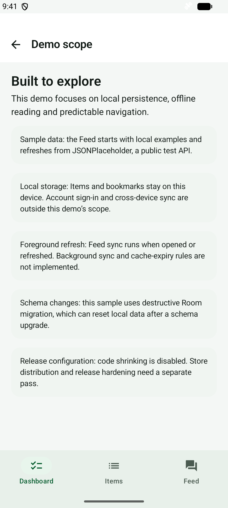
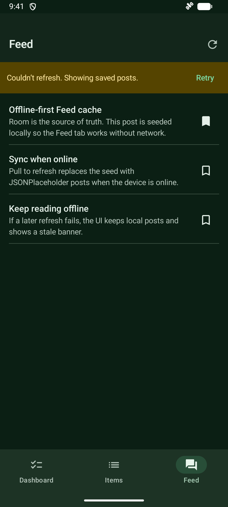

# Demo and technical review guide

A short path through the app, followed by source and test entry points.
Start with the [bookmark refresh case](EVIDENCE.md#lead-case-preserve-bookmark-toggles-during-refresh)
for a focused engineering discussion.

## 3-minute path

1. **Dashboard:** read the demo overview, then open **Demo scope** for storage and
   release boundaries.
2. **Items:** enter a title, tap **Add item**, then open it to edit notes. Relaunch
   to check persistence. Blank titles are rejected when adding and editing.
3. **Feed:** bookmark a post, then refresh. Disable connectivity and refresh again:
   saved posts remain visible with **Couldn’t refresh. Showing saved posts.**
4. **Deep link:** open `superdemo://feed/1`. A missing ID opens a clear
   **Post not found.** state.

Feed and Items start with local sample data on first launch. Online Feed refresh
replaces example posts with JSONPlaceholder content. Bookmarks remain local.

```bash
adb shell am start -a android.intent.action.VIEW -d "superdemo://feed/1" -p com.redjadet.superdemo.debug
```

## Technical review map

| Topic | Source / guide | Evidence |
| --- | --- | --- |
| Feature boundaries | [Architecture tour](architecture-tour.md), [layers](layers.md) | Domain contracts with data implementations and Hilt composition |
| Offline Feed | `CachingFeedRepository`, [offline-first](offline-first.md) | Unit tests + forced remote failure in `OfflineFeedInstrumentationTest` |
| Bookmark during refresh | [Lead case](EVIDENCE.md#lead-case-preserve-bookmark-toggles-during-refresh) | Concurrent network-wait regression |
| Refresh cancellation | `FeedViewModel`, `CachingFeedRepository` | Cancellation propagation and ViewModel state tests |
| Items persistence | `ItemLocal`, `ItemSeedStore` | Room CRUD and seed-once regression |
| Form validation | `ItemsViewModel`, `ItemDetailViewModel` | Add and edit validation tests |
| Deep links | `AppDeepLink`, `AppRoot` | Parsing tests + missing-post instrumentation |
| Layout and theme | `ReviewerContentWidth`, [design notes](../DESIGN.md) | Width breakpoint unit test; manual light/dark and large-text review |
| Build and runtime checks | [CI](ci.md), [local verification](local-proof.md) | Separate hosted API 34 and local emulator results |

## Demo scope

| Area | Current boundary |
| --- | --- |
| Data | JSONPlaceholder public test API; deterministic local examples for first launch |
| Persistence | Room drives Feed and Items; bookmarks are device-local |
| Sync | Foreground refresh; no remote bookmark outbox, account service or background worker |
| Schema | Destructive Room migration can reset stored data after a schema change |
| Release | Debug installation is the review path; shrinking, signing and store delivery need separate validation |
| Accessibility | Labeled actions, theme-aware colors and scrollable content; full TalkBack and device-matrix audits remain open |
| Lint | App sources are linted; test-source lint is disabled in the build configuration |

## Screenshots

Captured from the Android API 36 emulator with local sample data. Both Feed
images show a failed refresh while saved posts remain readable.

| Dashboard | Items | Offline Feed |
| :---: | :---: | :---: |
|  |  |  |

| Demo scope | Dark theme |
| :---: | :---: |
|  |  |
